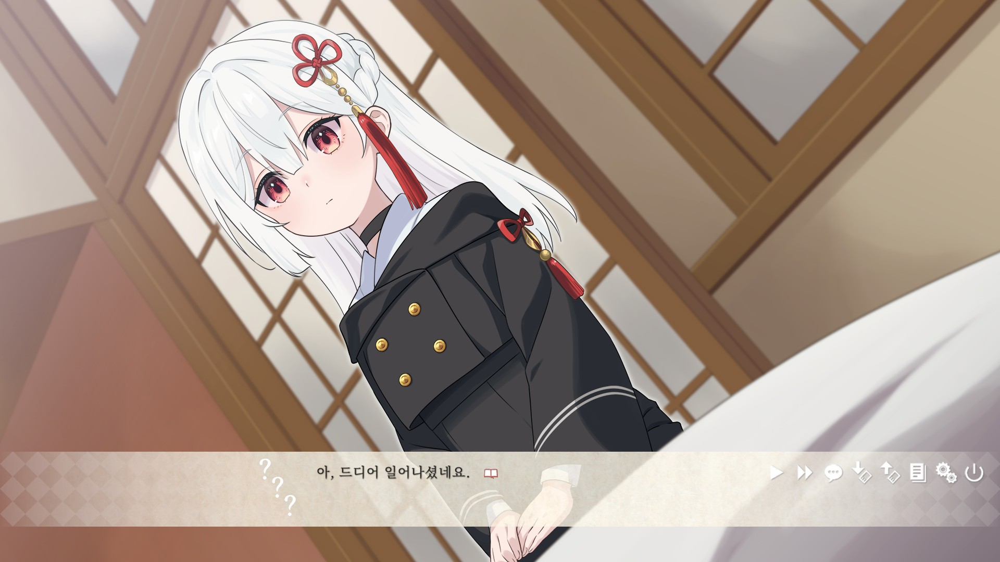
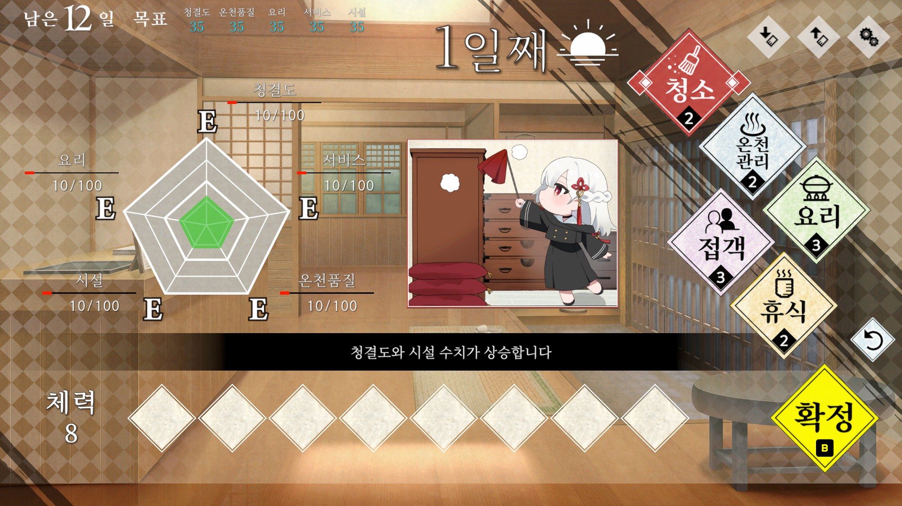

# 이계의 숙박부 한국어 패치

Steam판 **異界ノ宿帳** 비공식 한국어 패치 저장소입니다. 한국어 임시 명칭은 **이계의 숙박부**입니다.

패치 버전은 `v1.0.0`이며 Steam 앱 ID `4249520`, 게임 빌드 `26645119`, Windows x64 환경을 대상으로 합니다.

[Steam 공식 상점](https://store.steampowered.com/app/4249520/)

## 배포본

[최신 릴리스](https://github.com/etashi04/Guestbook/releases/latest)에서 다운로드할 수 있습니다.

- `Guestbook_Korean_Patch_v1.0.0.zip`: GUI 설치기를 통한 자동 설치·원본 복구
- `Guestbook_Korean_Patch_Manual_v1.0.0.zip`: 게임 실행 파일이 있는 폴더에 직접 복사
- `SHA256SUMS.txt`: 배포 ZIP 무결성 확인용 체크섬

게임을 종료한 상태에서 둘 중 하나만 설치하세요. 자동판에는 설치 EXE와 설치 안내문, 수동판에는 패치파일 폴더와 수동 전용 안내문이 포함되며, 두 배포본 모두 제3자 고지를 제공합니다.

## 자동 설치

게임을 종료한 상태에서 설치하세요. 게임 폴더와 세이브를 먼저 백업합니다.

1. 자동 설치 ZIP을 게임 폴더 밖에 모두 압축 해제합니다.
2. `이계의 숙박부 한국어 패치 v1.0.0.exe`를 실행합니다.
3. 자동으로 찾은 설치 경로를 확인하거나 **찾아보기**로 `Guestbook.exe`가 있는 게임 폴더를 선택하고 **한국어 패치 설치**를 누릅니다.
4. 완료 후 Steam에서 게임을 실행하고 표시 언어를 **일본어(日本語)**로 설정합니다.

설치 경로를 찾지 못하면 입력란이 빈칸으로 표시됩니다. 한국어는 일본어 슬롯을 사용합니다. 설치 EXE에 필요한 패치 파일이 들어 있으므로 별도 프로그램 설치는 필요 없습니다.

## 수동 설치

게임을 종료하고, 기존 자동 패치가 있다면 먼저 해당 설치기로 원본을 복구하세요.

1. 수동 설치 ZIP을 모두 압축 해제하고 `패치파일` 폴더를 엽니다.
2. ZIP의 `README.txt`에 적힌 원본 4개 파일을 게임 폴더 밖에 경로 구조 그대로 백업합니다. 세이브도 따로 보관합니다.
3. 안의 `Guestbook_Data` 폴더를 `Guestbook.exe`가 있는 경로에 복사하여 병합·덮어씁니다. `패치파일` 폴더 자체를 넣거나 `Guestbook_Data` 안에 한 번 더 넣지 않습니다.
4. Steam에서 게임을 실행하고 표시 언어를 **일본어(日本語)**로 설정합니다.

수동판은 완성된 패치 파일을 덮어쓰는 방식이며 별도 설치 도구나 Python 설치는 필요 없습니다. 원본 백업은 자동으로 생성되지 않습니다.

## 복구

- 자동판: 게임 종료 후 같은 설치기에서 같은 게임 폴더를 선택하고 **원본 복구**를 누릅니다. `_Guestbook_KR_Backup_v1.0.0`의 백업은 보존합니다. 복구 후에도 백업은 남으며, 같은 버전을 다시 설치할 때 정상 백업을 재사용합니다.
- 수동판: 게임 종료 후 설치 전에 백업한 원본 4개 파일을 같은 위치에 덮어씁니다. 수동 설치만 한 경우 자동 설치기의 복구에 필요한 백업이 없습니다.
- 원본 백업이 없거나 손상되었을 때, 또는 게임 업데이트 후에는 Steam의 **속성 → 설치된 파일 → 게임 파일 무결성 검사**로 원본을 복구합니다.

설치기와 수동 패치는 세이브·Steam 클라우드 설정을 변경하지 않습니다.

## 오류 해결

### 설치 경로·지원 버전 오류가 나올 때

- `Guestbook.exe`를 찾지 못하면 `Guestbook_Data` 폴더가 아니라 실행 파일이 있는 상위 게임 폴더를 선택하세요.
- 빌드가 다르거나 알 수 없는 파일 변경이 있다고 나오면 지원 빌드 `26645119`인지 확인하세요. 기존 패치나 다른 모드로 수정된 상태라면 원본을 복구한 뒤 설치합니다. 게임이 더 새 버전이라면 해당 빌드에 대응하는 패치가 필요합니다.
- 파일을 열 수 없다고 나오면 게임과 해당 파일을 사용하는 프로그램을 종료하세요. 설치 폴더에 쓰기 권한이 없다면 설치기를 관리자 권한으로 실행합니다.
- 원본 백업이 없거나 손상되었다고 나오면 기존 백업을 보존하고 Steam의 **게임 파일 무결성 검사**를 이용하세요.

### 설치 EXE 실행이 차단될 때

설치 EXE가 Windows에서 차단된다면 **수동 설치판**을 이용할 수 있습니다. 수동판은 설치 EXE를 실행하지 않고 `패치파일` 내용을 복사하는 방식입니다. 게임 본체의 실행이 차단된 경우에는 수동 설치만으로 해결되지 않을 수 있습니다.

문제가 계속되면 오류 문구와 파일명을 확인한 뒤 저장소의 [이슈(Issues) 탭](https://github.com/etashi04/Guestbook/issues)에 제보해 주세요. 패치 버전, 장·장면, 앞뒤 대사, 화면 캡처와 재현 방법을 함께 적어 주세요. 로그·스크린샷·세이브를 공개할 때는 사용자 이름과 개인 경로를 가려 주세요.

## 주의

- 원작자·개발사·배급사와 무관한 비공식 한국어 팬 패치입니다.
- 게임 업데이트 후 호환되지 않을 수 있습니다.
- 배포 파일은 `SHA256SUMS.txt`로 무결성을 확인할 수 있습니다.
- 정품 게임이 필요합니다. 게임 실행 파일·음성·개인 세이브·게임 통합본은 배포하지 않습니다.
- 제작자 이름·로고 등 원본의 일부 원어 표기는 유지합니다. 한국어 음성은 제공하지 않습니다.
- 체험판 종료용 JP 소개 영상의 한국어 자막을 포함합니다. 이 영상은 본편 엔딩에서는 원래 재생되지 않으며 재생 조건은 변경하지 않았습니다.
- 동봉 글꼴 등의 라이선스는 [THIRD_PARTY_NOTICES.txt](THIRD_PARTY_NOTICES.txt)에 있습니다.
- 다른 빌드·운영체제·모드와의 조합은 보장하지 않습니다. 설치 후 파일을 직접 수정하면 자동 복구가 중단될 수 있으므로 파일과 백업을 보존하세요.
